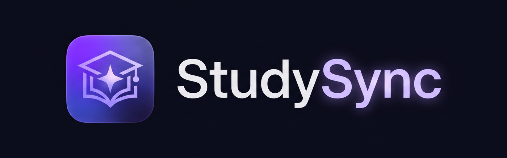
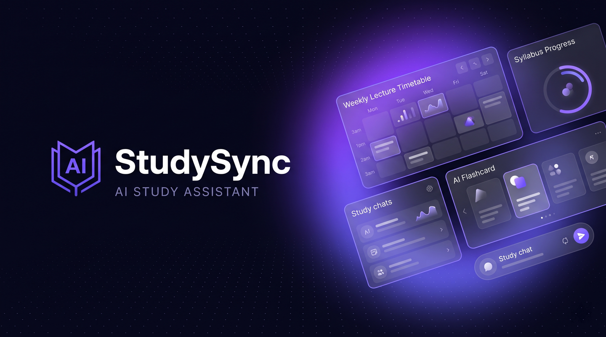

<p align="center">
  
</p>

<p align="center">
  <strong>AI-powered academic command center for schedules, notes, flashcards, mock exams, and deadline tracking.</strong>
</p>

<p align="center">
  
  
  
  
  
  
</p>

<p align="center">
  
</p>

---

## Highlights

| Area | Capabilities |
| :--- | :--- |
| **Timetable & Calendar** | Week, Month, and Day views with recurring slots and AI image/PDF timetable extraction |
| **Deadlines & Alerts** | Exam/assignment countdowns, WhatsApp chat extractor, and configurable Web Push reminders |
| **Notes Vault** | Subject-organized Kanban folders for PDF/PPTX/DOCX with AI categorization & topic extraction |
| **Syllabus Progress** | Module mastery checklist paired with daily exam pacing metrics |
| **Practice Studio** | Module-scoped spaced-repetition flashcards and sample-paper-guided mock exams |
| **AI Tutor & Utilities** | Streaming context-aware chat (Ollama, OpenAI, Gemini), Pomodoro focus timer & AI scratchpad |
| **Mobile PWA** | Installable mobile/desktop app with background service worker notifications |

---

## Quick Start

### Option 1 — Docker Compose (PostgreSQL + Auto-Sync)

```bash
cp .env.example .env
# Set a strong BETTER_AUTH_SECRET and your BETTER_AUTH_URL in .env

docker compose up -d --build
```

The entrypoint waits for PostgreSQL, runs `prisma db push` automatically, and starts the server at `http://localhost:3000`.
If using Ollama on your Docker host, configure the AI base URL in **Settings** to `http://host.docker.internal:11434/v1`.

### Option 2 — Local Development (SQLite)

```bash
npm install
cp .env.example .env
npx prisma db push
npm run dev
```

Open `http://localhost:3000`, create an account, and configure your AI provider in **Settings**.

---

## Tech Stack

- **Framework:** Next.js 16 (App Router, React 19, Tailwind CSS v4)
- **Database:** Prisma (`pg` for Docker/Postgres, `@libsql/client` for local SQLite)
- **Auth:** Better Auth (Email/Password & optional Google OAuth)
- **AI Layer:** Unified prompt & request gateway supporting Ollama, OpenAI-compatible APIs, and Google Gemini
- **PWA / Notifications:** Web App Manifest, Service Worker, `web-push` (VAPID)
